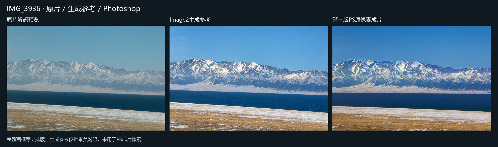
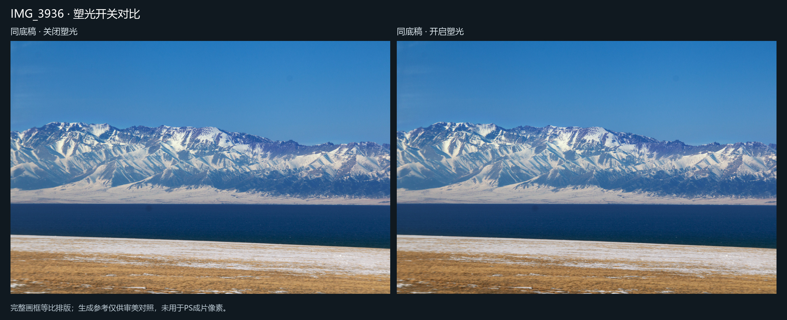
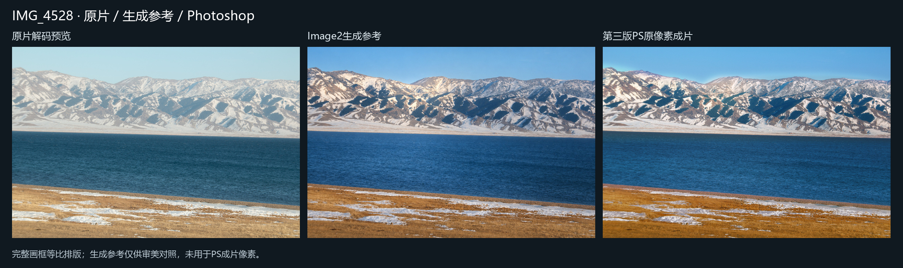
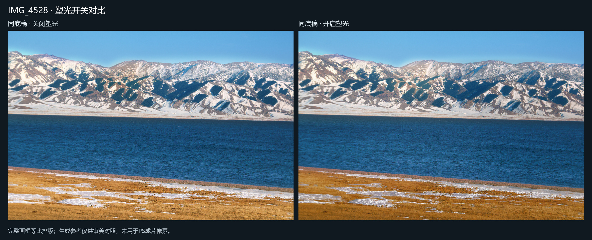

# 原片精修 · Image2 + Photoshop

用 Image2 选择摄影后期的审美方向，用 ChatGPT 实际观察照片、设计局部光影，再由 Photoshop 对原片建立可编辑曲线和蒙版。生成参考的像素不会进入成片。

工作流程：检查原片与100%焦点 → 逐张生成参考 → 记录主光、视觉落点、受光/背光面与环境反射 → 标注并实际查看蒙版预览 → 原生 Photoshop 工作样 → 塑光开关和100%细节复核 → 保存16位PSD与sRGB JPEG → 真正重新打开PSD核验。执行成功与视觉验收分别记录。

从 [SKILL.md](skills/original-photo-retouch/SKILL.md) 开始。具体参数见 [配方与执行](skills/original-photo-retouch/references/recipe.md)、[模型标注](skills/original-photo-retouch/references/vision-annotations.md)、[光影设计](skills/original-photo-retouch/references/light-design.md)。

## 环境

Windows、已安装并可正常工作的 Photoshop、Python 3.12。核心 Python 依赖为 `pywin32`、`Pillow`、`numpy`；RAW独立检查可选 `rawpy`，PDF图册可选 `PyMuPDF`。图像生成使用 Codex 内置 image_gen。首次使用先进行一张小样，验证本机 Photoshop 的解码、蒙版、保存和正常退出。

将本仓库作为本地 Codex 插件或把技能目录安装到自己的技能目录；脚本相对仓库定位。Photoshop 路径由调用者明确指定，不假定安装位置：

```powershell
python -m pip install pywin32 Pillow numpy
python -X utf8 scripts/photoshop_job.py .\my-recipe.json --validate-only
& .\scripts\run_fresh_photo.ps1 -RecipePath .\my-recipe.json -PhotoshopPath 'C:\YourApps\Photoshop\Photoshop.exe' -SessionMode Standard
& .\scripts\run_psd_inspection.ps1 -PsdPath .\output.psd -ProofPath .\output-proof.json -PhotoshopPath 'C:\YourApps\Photoshop\Photoshop.exe'
```

配方及标注由实际看图后逐张编写，不能把例图的蒙版套到其他照片。最终 PSD 保留原片解码的内嵌智能对象、独立调整层和蒙版。局部塑光可按明度范围加权；近白雪面仍抢亮时，可显式调低该局部白点，避免只压暗中间调。

## 稳定运行

原生调用使用跨进程串行锁、持久状态和截止时间。结果未知时阻止下一次提交；先核对已有输出，避免重复保存。已保存成果与退出状态分别持久化。正常退出前只读确认零文档，保留用户文档；不通过删锁、强杀或修改网络来跳过保护。标准模式要求输出盘至少16GiB余量，空间不足时在提交前停止。

## 实例与经验

实例目录仅放经过人工查看的无人物风景JPEG，并重新编码清除EXIF/GPS。标明原片解码预览、生成参考、认可的第二版和第三版塑光，避免将生成参考当成原片成果。照片仅用于展示本流程，未授予额外再分发许可。

[复盘与限制](docs/lessons.md)：重点是从逐区域光色匹配走向有明确视觉落点的主动塑光，同时保留原图的光学柔化、噪声和真实纹理。工具不能恢复原片已经丢失的信息，也没有自动“大师水平”评分。

## 风景展示

| 示例 | 内容 |
| --- | --- |
| [雪鞍与湖岸](examples/IMG_3936/README.md) | 原片、生成参考、第二版、塑光关闭、第三版 |
| [坡面体积与前景退让](examples/IMG_4528/README.md) | 同底稿开关对照，保护谷地冷反射 |









0.4.0在36张原片上逐张执行并实际验收；全部最终PSD已在Photoshop重新打开核验。公开仓库仅含上述两组无人物预览，人物照片和完整项目记录保留在本地。
