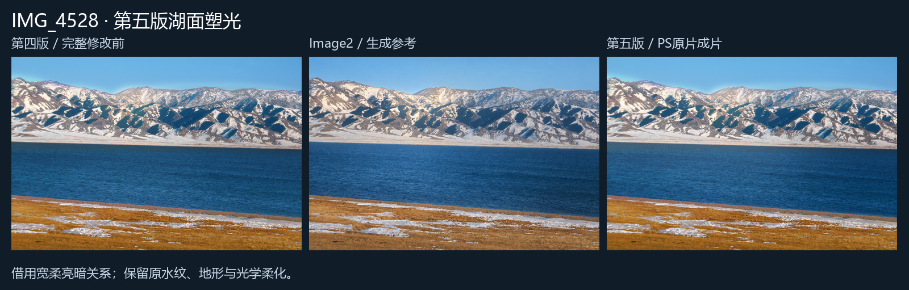
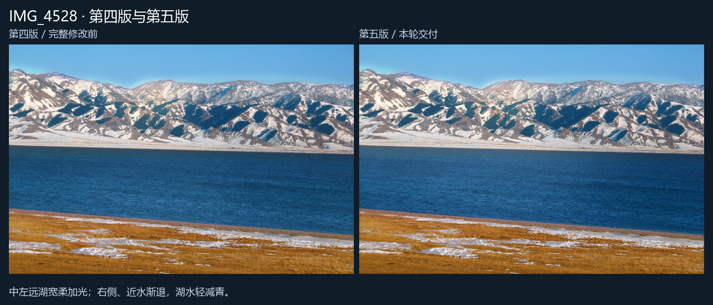

# 原片精修 · Image2 + Photoshop

用 Image2 选择摄影后期的审美方向，用 ChatGPT 实际观察照片、设计局部光影，再由 Photoshop 对原片建立可编辑曲线和蒙版。生成参考的像素不会进入成片。

工作流程：实际观察原片、旧成片与100%细节 → 先诊断光影、污点、玻璃反射及构图干扰 → 把逐项修正目标写入新Image2参考 → 记录主光、视觉落点、受光/背光面与环境反射 → 标注并实际查看蒙版预览 → 原生 Photoshop 工作样 → 逐缺陷、塑光开关和100%细节复核 → 保存16位PSD与sRGB JPEG → 真正重新打开PSD核验。执行成功与视觉验收分别记录。

从 [SKILL.md](skills/original-photo-retouch/SKILL.md) 开始。具体参数见 [配方与执行](skills/original-photo-retouch/references/recipe.md)、[模型标注](skills/original-photo-retouch/references/vision-annotations.md)、[光影设计](skills/original-photo-retouch/references/light-design.md) 和 [局部修复与保留图层续修](skills/original-photo-retouch/references/repair-and-revision.md)。

[缺陷诊断先于参考](skills/original-photo-retouch/references/defect-first.md)说明如何区分主体与干扰、绑定实际观察与新参考，以及同片场景修复的限制。新修图按此流程执行；历史已验收配方保持兼容，不倒填观察证据。

## 环境

Windows、已安装并可正常工作的 Photoshop、Python 3.12。核心 Python 依赖为 `pywin32`、`Pillow`、`numpy`；RAW独立检查可选 `rawpy`，PDF图册可选 `PyMuPDF`。图像生成使用 Codex 内置 image_gen。首次使用先进行一张小样，验证本机 Photoshop 的解码、蒙版、保存和正常退出。

将本仓库作为本地 Codex 插件或把技能目录安装到自己的技能目录；脚本相对仓库定位。Photoshop 路径由调用者明确指定，不假定安装位置：

```powershell
python -m pip install pywin32 Pillow numpy
python -X utf8 scripts/photoshop_job.py .\my-recipe.json --validate-only
& .\scripts\run_fresh_photo.ps1 -RecipePath .\my-recipe.json -PhotoshopPath 'C:\YourApps\Photoshop\Photoshop.exe' -SessionMode Standard
& .\scripts\run_psd_inspection.ps1 -PsdPath .\output.psd -ProofPath .\output-proof.json -PhotoshopPath 'C:\YourApps\Photoshop\Photoshop.exe'
```

配方及标注由实际看图后逐张编写，不能把例图的蒙版套到其他照片。最终 PSD 保留原片解码的内嵌智能对象、独立调整层和蒙版。局部塑光可按明度范围加权；近白雪面仍抢亮时，可显式调低该局部白点，避免只压暗中间调。

0.5.0支持从已验收PSD追加独立图层：原片、既有PSD、配方、执行回执及真实重开证明按哈希绑定，另存新路径。模型实际观察到的小灰点，可从同片相邻干净区域做小范围柔边克隆；它不使用生成像素或自动内容识别。新增曝光响应曲线用于顺原光方向提亮受光面，仍需人工观察体积、白端和肤色，不能据此声称物理重照明。面部适度补光与减色保留纹理和身份特征，未实现自动磨皮或自动人脸修复。

0.5.1增加宽光场与窄边缘保护分开控制：`broad_feather_px` 先对单个正轮廓执行多次原生羽化，再扣除各自窄羽化的岸线或主体保护。尺度按原生画幅限制，必须重新观察蒙版和成片；它不是自动识别，也不能复制生成参考的波纹。湖面需单独验收左右、远近的明暗关系，山坡已有体积不能代替湖面检查。

## 稳定运行

原生调用使用跨进程串行锁、持久状态和截止时间。结果未知时阻止下一次提交；先核对已有输出，避免重复保存。已保存成果与退出状态分别持久化。正常退出前只读确认零文档，保留用户文档；不通过删锁、强杀或修改网络来跳过保护。标准模式要求输出盘至少16GiB余量，空间不足时在提交前停止。

## 实例与经验

实例目录仅放经过人工查看的无人物风景JPEG，并重新编码清除EXIF/GPS。标明原片解码预览、生成参考、认可的第二版和第三版塑光，避免将生成参考当成原片成果。照片仅用于展示本流程，未授予额外再分发许可。

[复盘与限制](docs/lessons.md)：重点是从逐区域光色匹配走向有明确视觉落点的主动塑光，同时保留原图的光学柔化、噪声和真实纹理。工具不能恢复原片已经丢失的信息，也没有自动“大师水平”评分。

## 风景展示

| 示例 | 内容 |
| --- | --- |
| [雪鞍与湖岸](examples/IMG_3936/README.md) | 原片、生成参考、第二版、塑光关闭、第三版 |
| [坡面体积与前景退让](examples/IMG_4528/README.md) | 同底稿开关对照，保护谷地冷反射 |
| [第五版：湖面宽柔亮区](examples/IMG_4528/v5/README.md) | 四五版完整对照、生成参考、同次4个光层开关 |


0.4.0在36张原片上逐张执行并实际验收；全部最终PSD已在Photoshop重新打开核验。公开仓库仅含上述两组无人物预览，人物照片和完整项目记录保留在本地。

0.5.0再次逐张复核同一批36张：5张按需追加修改，31张保留已验收第三版。追加修改覆盖天空圆斑、受光面微补光、自然脸侧减红及实际水平校正；文件核验与100%指定细节观察分别记录。40项自动测试验证参数和证据约束，实际视觉和原生Photoshop验收另行完成。上面的公开对比仍明确展示第三版，不冒充第四版新增效果；本轮其余照片仅本地交付。Git标签 `v0.4.0` 和 `approved-v2-20261019` 保留旧流程以便回滚。

0.5.1复审同一批全部36张，重点重修IMG_4528湖面，35张保留第四版。中左远湖宽柔加光，右侧和近水渐退并轻减青，保留原细波与湖岸；最终5472×3648、16位sRGB、21图层PSD已实际重开。36号另检查6处原生1:1局部，其他35张本轮全幅复审继承第四版已记录的原生细节范围。43项测试验证参数和证据约束，不代替视觉验收。污点须有原生形态证据；透视斜岸、山脊和道路消失线不能直接作为水平基准。





0.6.0加入原片/实看图/新参考的哈希绑定及诊断时间次序校验；同片场景修复仅允许模型复核的整数平移取样，限制面积、羽化和边界，并保护真实结构。光影先组织明度与宽光场，再校正颜色；每轮仍须看PS实际反馈。全部36张再次全幅复审，3张按需重修、33张保留已有成果；新增3张最终PSD已实际重开，48项自动测试通过。新增照片与私人核对记录仅本地交付，公开展示继续沿用上面已授权的历史风景案例，不把它们标作本轮新效果。
