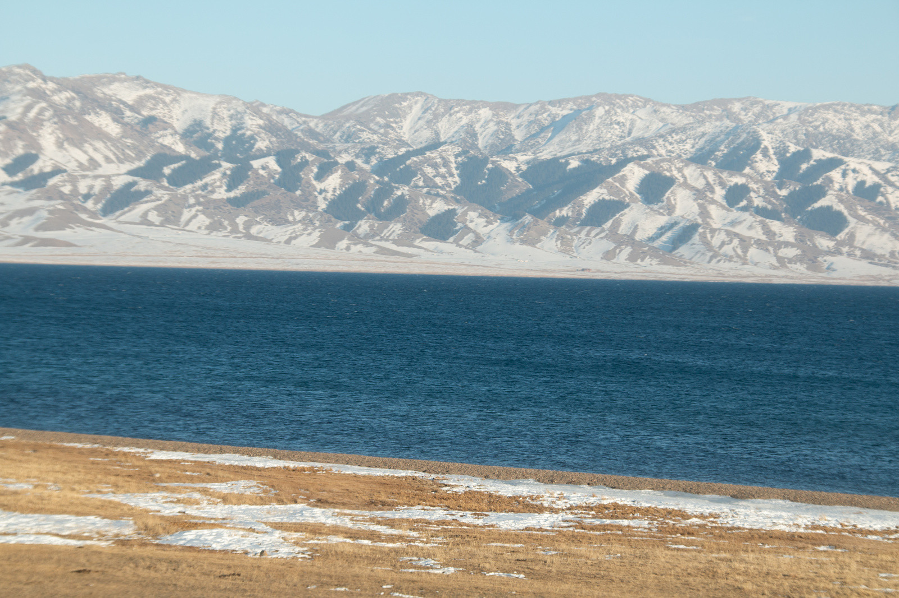
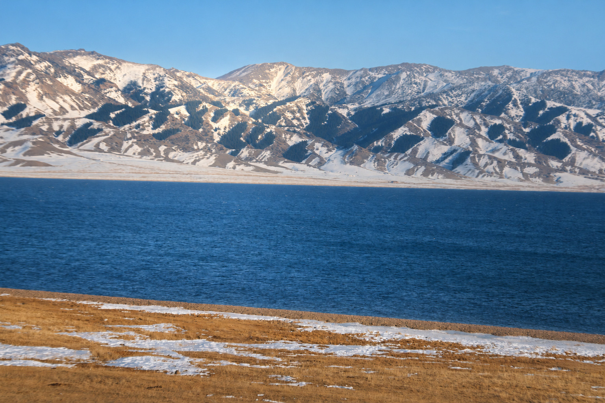
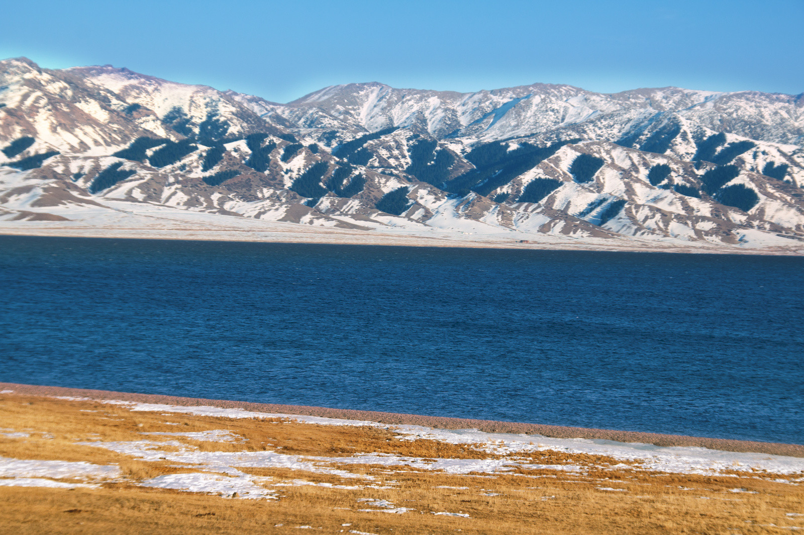
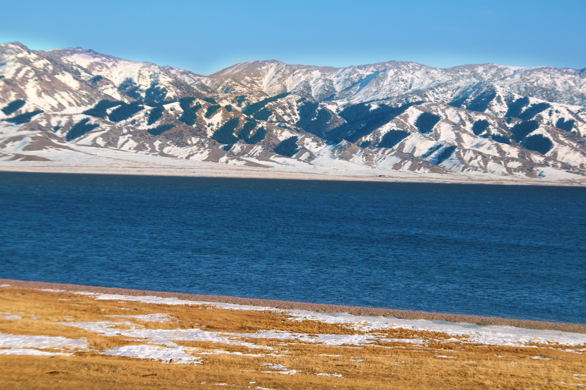
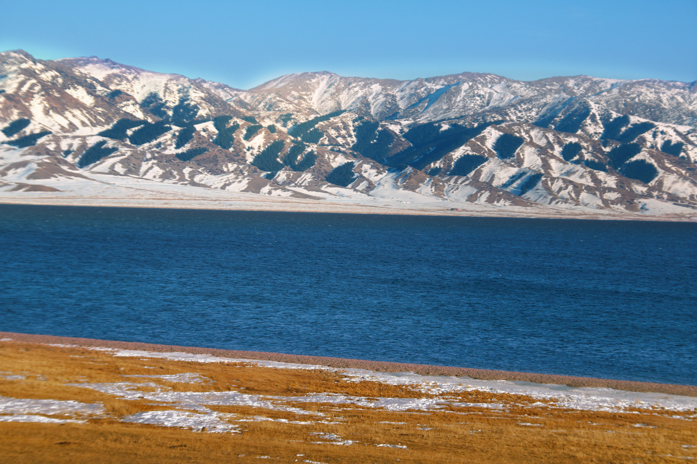

# IMG_4528 · 雪山湖岸

此组仅展示经过人工查看、未见人物的风景。JPEG最长边不超过1600像素，已清除EXIF/GPS；完整PSD与原片保存在本地。

Image2是生成参考，仅借用可实现的光影与颜色。最终图来自Photoshop原像素，保留原片的空气透视、车窗柔化、颗粒和近景拖影；参考中的新纹理没有复制到成片。

## 原片解码预览

## Image2生成参考

## 认可第二版

## 第三版关闭新增塑光

## 第三版 Photoshop 成片

## 本轮塑光

主雪鞍与原受光凸坡作为第一落点，相邻谷地保持冷天光；前草、近雪与竞争山群宽柔退让。关闭新增塑光与成片来自同一原生底稿和几何，仅关闭指定的本轮塑光图层。

展示照片未授予额外再分发许可。
