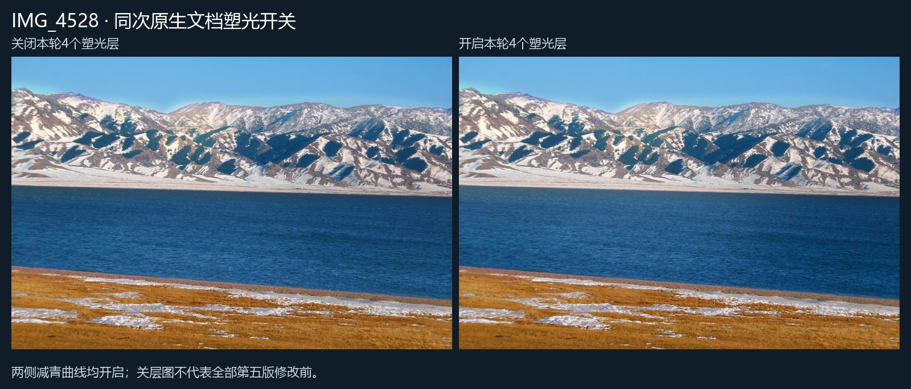

# IMG_4528 · 第五版湖面塑光

第四版对湖水的中左至右侧、远水至近水的宽柔明暗组织不足。本轮增加中左远湖宽柔光场、远湖衔接、右侧和近水退让，并轻减青，保留原细波、地形、光学柔化和前景拖影。Image2仅为生成参考，其像素没有进入成片。

全部展示图最长边不超过1600像素、重新编码清除EXIF/GPS，实际观察未见人物。原片、PSD和私有验收记录均保存在本地；照片未授予额外再分发许可。[第三版历史示例](../README.md)保留。

## 第四版 / Image2参考 / 第五版

## 完整修改前后

左侧是本次原生文档导出的完整修改前，与第四版成片解码像素一致。右侧是第五版交付。两侧包含本轮全部明度及轻减青修改。

## 同次文档的指定光层开关

只切换“中左宽柔加光、远湖反射衔接、右侧退让、近水收光”4层；减青曲线两侧均开启，不能把左侧称为全部修改前。两侧的相机画幅、结构和真实水纹保持一致。

最终本地PSD为5472×3648、16位sRGB、21个可编辑图层，含原片智能对象，已真正重新打开核验。整图及水纹、远近岸、天空、雪鞍、山脊6处原生1:1局部已实际查看，未观察到新增灯斑、条带或湖岸光圈；此范围不等于穷尽整幅所有像素。宽羽化和窄边缘保护都需按每张照片重新标注，不能把此配方套用到所有湖水。
